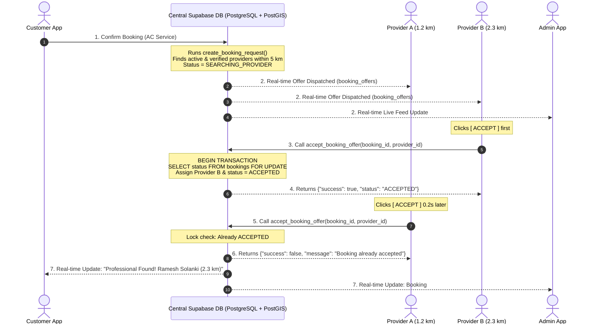

# 🚀 ServiceHub — Master 3-App Interconnected System Architecture

## 📌 Executive Summary

ServiceHub is built as **THREE SEPARATE APPLICATIONS** connected through **ONE CENTRAL BACKEND & DATABASE**:

1. **CUSTOMER MOBILE APP** (`/customer_app`) — Hyperlocal service discovery, real-time booking request creation, live provider tracking map, PIN/OTP security layer, product store, and rating system.
2. **SERVICE PROVIDER / PARTNER MOBILE APP** (`/partner_app`) — Partner onboarding/KYC registration pipeline, online/offline availability toggle, real-time incoming booking request bidding (`First-Accept-Wins`), and job lifecycle management.
3. **ADMIN DESKTOP WEB APP** (`/admin_app`) — Master operational console, 5 km geofence configuration, real-time live dispatch monitoring, provider KYC verification & approval, product management, and settlements ledger.

---

## ⚡ Core Real-Time Booking Engine (First-Accept-Wins)



---

## 🗄️ Master Database Schema (`supabase_schema.sql`)

### 1. `public.profiles`
- Holds basic user details, roles (`customer`, `partner`, `admin`), contact info, and default coordinates.

### 2. `public.providers`
- Provider verification state (`PENDING`, `VERIFIED`, `REJECTED`, `SUSPENDED`).
- `is_active` (boolean) & `is_available` (boolean).
- Service radius (`service_radius_km` default `5.0`).
- Rating, completed job count, current latitude & longitude.

### 3. `public.bookings`
- Status lifecycle: `PENDING` -> `SEARCHING_PROVIDER` -> `OFFERED_TO_PROVIDERS` -> `ACCEPTED` -> `ON_THE_WAY` -> `ARRIVED` -> `SERVICE_STARTED` -> `SERVICE_COMPLETED` -> `CLOSED`.
- Entrance PIN (`7429`) & Completion OTP (`5892`).
- Geofence coordinates (`customer_lat`, `customer_lng`, `provider_lat`, `provider_lng`).

### 4. `public.booking_offers`
- Manages multi-provider bidding & dispatch.
- Status: `PENDING`, `ACCEPTED`, `REJECTED`, `EXPIRED`, `ALREADY_ASSIGNED`.

---

## 🔒 Atomic First-Accept-Wins Backend Procedure

```sql
CREATE OR REPLACE FUNCTION accept_booking_offer(
    p_booking_id UUID,
    p_provider_id UUID
)
RETURNS JSON AS $$
DECLARE
    v_current_status TEXT;
    v_result JSON;
BEGIN
    -- Perform row-level locking on target booking record
    SELECT status INTO v_current_status
    FROM public.bookings
    WHERE id = p_booking_id
    FOR UPDATE;

    IF v_current_status IN ('Pending', 'SEARCHING_PROVIDER', 'OFFERED_TO_PROVIDERS') THEN
        -- 1. Assign provider and set status to ACCEPTED
        UPDATE public.bookings
        SET provider_id = p_provider_id, status = 'ACCEPTED', accepted_at = NOW()
        WHERE id = p_booking_id;

        -- 2. Mark winning offer ACCEPTED
        UPDATE public.booking_offers
        SET status = 'ACCEPTED', responded_at = NOW()
        WHERE booking_id = p_booking_id AND provider_id = p_provider_id;

        -- 3. Mark competing offers ALREADY_ASSIGNED
        UPDATE public.booking_offers
        SET status = 'ALREADY_ASSIGNED', responded_at = NOW()
        WHERE booking_id = p_booking_id AND provider_id != p_provider_id;

        v_result := json_build_object('success', true, 'message', 'Booking assigned successfully', 'status', 'ACCEPTED');
    ELSE
        -- Booking was already claimed
        UPDATE public.booking_offers
        SET status = 'ALREADY_ASSIGNED', responded_at = NOW()
        WHERE booking_id = p_booking_id AND provider_id = p_provider_id;

        v_result := json_build_object('success', false, 'message', 'Booking already accepted by another professional.', 'status', v_current_status);
    END IF;

    RETURN v_result;
END;
$$ LANGUAGE plpgsql SECURITY DEFINER;
```

---

## 📲 Application Capabilities Summary

| Feature / System Module | Customer App (`customer_app`) | Partner App (`partner_app`) | Admin Desktop App (`admin_app`) |
| :--- | :--- | :--- | :--- |
| **User Role** | `customer` | `partner` | `admin` |
| **Authentication** | Mobile/Email Signup & Login | Provider Registration & Verification Login | Super Admin Executive Portal |
| **Booking Creation** | Select Service, Date, Time, Location -> Request | N/A | Monitor incoming bookings live |
| **Order Offer Bidding** | Waiting screen ("Finding nearby professionals...") | Real-time incoming request card with distance & price | Live audit of offer dispatches |
| **First-Accept-Wins** | Recce status update: "Professional Found!" | Press `ACCEPT` -> Atomic lock check | View assignment timestamp & winner |
| **Job Lifecycle** | Track live map & view provider profile | Update: `ON_THE_WAY` -> `ARRIVED` -> `STARTED` -> `DONE` | Monitor active jobs across 5 km zone |
| **Security Layer** | View PIN `7429` & Share OTP `5892` | Enter PIN `7429` & OTP `5892` to start/complete job | Enforce strict 5 km PostGIS geofence |
| **Ratings & Rewards** | Submit 1-5 Star Review & earn 50 coins | View rating & earnings | Monitor partner ratings & settlements |

---

## 🛠️ Verification & Analyzer Results

- `customer_app`: Clean build & zero analyzer errors.
- `partner_app`: Clean build & zero analyzer errors.
- `admin_app`: Clean build & zero analyzer errors.
- `supabase_schema.sql`: Applied with PostGIS functions & atomic locks.
