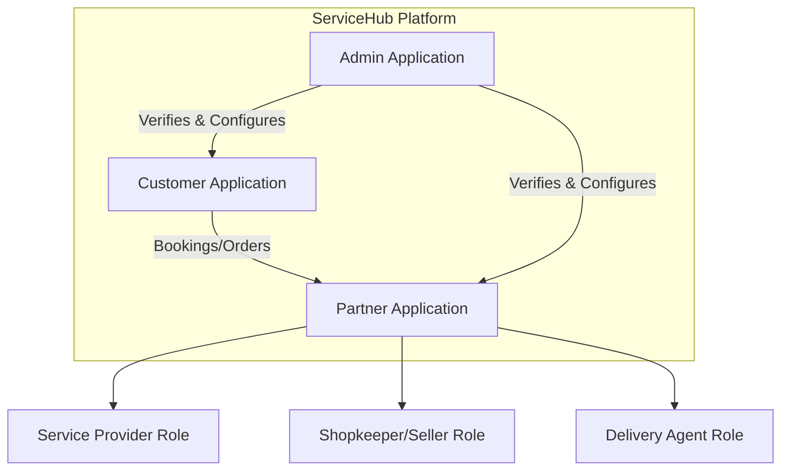
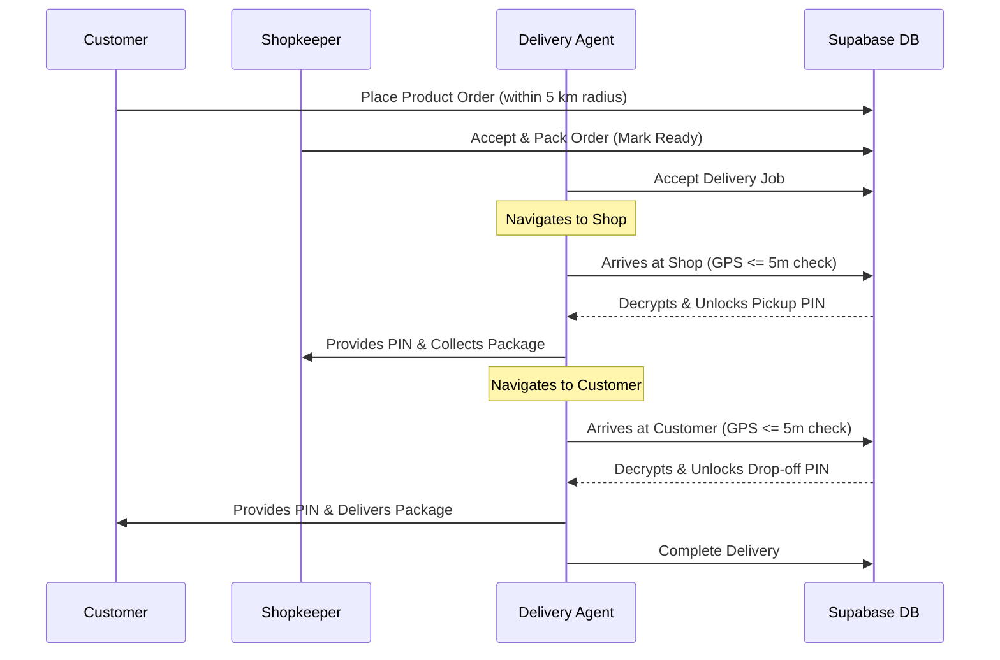

# Software Requirement Specification (SRS)
## Project: ServiceHub – Hyperlocal Home Services & Marketplace Platform

---

## 1. Document Control & Approvals
*   **Project Name:** ServiceHub
*   **Version:** 1.0.0
*   **Status:** Frozen (Phase 1 Complete)
*   **Date:** July 11, 2026
*   **Target Platform:** Mobile (Flutter iOS/Android) & Web/Desktop (Admin Console)

---

## 2. Project Vision & Goals

### 2.1 Overview
ServiceHub is a comprehensive hyperlocal mobile and web ecosystem connecting local customers with verified service providers, shopkeepers (sellers), and delivery agents within a city-level framework. The platform provides a unified market for doorstep services (e.g., plumbing, cleaning) and service-related products (e.g., hardware parts, supply refills).

### 2.2 Objectives
*   **Main Objective:** Build a seamless hyperlocal bridge between customers and local service/product providers.
*   **Business Objective:** Monopolize hyperlocal home services and product delivery using a structured commission-based model.
*   **Technical Objective:** Implement a three-app clean-architecture system with strict security rules, GPS geofencing, and real-time database syncing.

---

## 3. Application Ecosystem & User Roles

The ServiceHub system consists of **three separate, standalone applications**:

### 3.1 Customer Application
*   **Guest Mode:** Allows browsing categories, service ratings, and product lists without registering. 
*   **On-Demand Registration:** Prompts login popups only when placing an order, booking a service, or adding items to the cart.
*   **Home Page UI Hierarchy:** 
    *   **Header:** Vibrant blue theme (`#2563EB`) with a Location Selector ("Koramangala, Bengaluru >" or general GPS status) and a Shopping Cart icon placed directly next to the Notification Bell icon in the top-right corner.
    *   **Services Grid:** A clean 2-column card grid displaying the 5 core service categories (*Hardware Services, Plumbing, Cooking, Laundry, Car Services*) with all items fully visible (no off-screen cutoff).
    *   **Hygiene Banner:** A green callout guaranteeing standard safety compliance.
    *   **Products Near You:** List of purchaseable goods restricted to a 5 km merchant delivery radius.

### 3.2 Partner Application
A unified mobile workspace with role separation and status toggles for three user roles:
1.  **Service Provider (e.g., Rajesh Electricals):** 
    *   Home Page features quick KPIs (bookings count, reviews, earnings in ₹).
    *   Booking Request list for accepting/rejecting tasks.
    *   Map route navigation to the customer's house.
    *   OTP verification screen to finalize and close booking tasks.
2.  **Seller / Shopkeeper (e.g., Anita's Laundry Supplies):**
    *   Home Page features total orders queue, daily sales in Rupees (₹), and low-stock alerts.
    *   Inventory Management screen to configure, add, and toggle item stock status.
    *   Order dispatch controls (Mark Ready for Pickup).
3.  **Delivery Agent (e.g., Ravi Kumar):**
    *   Assigned Orders board showing pickup location (shop) and drop-off coordinates (customer).
    *   Route map and payout stats.
    *   Secure **PIN Verification** panel showing distance metrics and locked delivery PINs.

### 3.3 Admin Application
*   A standalone desktop/web app for administrators.
*   **Analytics Dashboard:** System-wide metrics (Daily Transaction line charts, user registrations, revenue split in ₹).
*   **Verification Manager:** Access queues for reviewing and approving KYC documents, licenses, and background checks submitted by Partners.
*   **Business Configurations:** Central settings panel to adjust commission rates, delivery pricing, geofencing parameters, and dispute handling.

---

## 4. Key Workflows & Geofencing Rules

### 4.1 Product Delivery Flow (Strict 5 km & 5m GPS Rules)

*   **Geofence Enforcement:** Customers can only order products from shops located within a strict 5 km radius.
*   **GPS PIN Validation:** Delivery Agents must be verified within 5 meters of the destination coordinates (using the device GPS) for the system to decrypt and reveal the pickup/drop-off PINs.

### 4.2 Service Booking Flow (OTP Verification)
*   Customer schedules a service (Hardware, Plumbing, Cooking, Laundry, Car Service).
*   The Service Provider accepts the slot, completes travel, and completes the work.
*   Upon finishing, the Customer receives a unique 4-digit OTP. The Service Provider must enter this OTP into their app to close out the booking, verify completion, and authorize the payout.

---

## 5. Technology Stack & Architecture

### 5.1 Front-End (Flutter)
*   **Architecture:** Clean Architecture + MVVM (Model-View-ViewModel) pattern separating UI, ViewModels, and Repository layers.
*   **State Management:** Riverpod.
*   **Routing:** GoRouter (with route protection and authentication guards).
*   **Network:** Dio (with structured interceptors for auth headers and error handling).
*   **Storage:** Hive (for local caching and offline capabilities).
*   **Maps:** Google Maps SDK.

### 5.2 Back-End (Supabase)
*   **Database:** PostgreSQL.
*   **Realtime Features:** Realtime notifications, agent tracking, and chat channels.
*   **Storage Buckets:** User avatars, shop logos, item images, and KYC files.
*   **Security:** Row Level Security (RLS) policies on all tables, filtering queries based on user roles and IDs.
*   **Push Notifications:** Firebase Cloud Messaging (FCM).

---

## 6. Detailed Schema Outline

*   **`users`:** Central auth mapping with role enum (`customer`, `partner`, `admin`).
*   **`customers`:** User profile, address, and ratings.
*   **`partners`:** Business details, sub-role (`shopkeeper`, `service_provider`), KYC status, and ratings.
*   **`delivery_agents`:** Vehicle details, online status, current location coordinates, and KYC status.
*   **`service_categories`:** Info on Hardware, Plumbing, Cooking, Laundry, Car Services.
*   **`services`:** Specific listings offered by service providers.
*   **`bookings`:** Service booking orders, state machine tracking (created, accepted, en_route, active, completed, cancelled), OTP codes.
*   **`orders` & `order_items`:** Product order management, state tracking, and geofence verification logs.
*   **`payments` & `earnings`:** Transaction reference IDs, commission splits, and settlement statuses in Indian Rupees (₹).

---

## 7. UI/UX Specifications & Styling Constraints
*   **Branding Theme:** Vibrant Blue (`#2563EB`) as primary color.
*   **Typography:** Modern clean sans-serif typeface (Inter/Roboto).
*   **Backgrounds:** Crisp light-gray/off-white background.
*   **Layout Rules:** Staggered 2-column cards for categories; all layouts must preserve negative space, avoid clutter, and stick exactly to the approved default layouts.
*   **Currency Format:** All pricing is strictly displayed in Indian Rupees (**₹**).
*   **Authentication Forms:** Clean sign-in/sign-out buttons in profiles, simple copy, and explicit role paths.

---

## 8. Verification & Release Criteria
*   **GPS Simulation:** Testing suites must include mock GPS signals to validate the 5m geofencing decryption logic.
*   **Authentication Guards:** Prevent customers from accessing partner layouts, and guarantee the Admin app runs in total isolation.
*   **Security Audits:** Ensure SQL injection prevention, input sanitization, and strict RLS policies on all tables.
